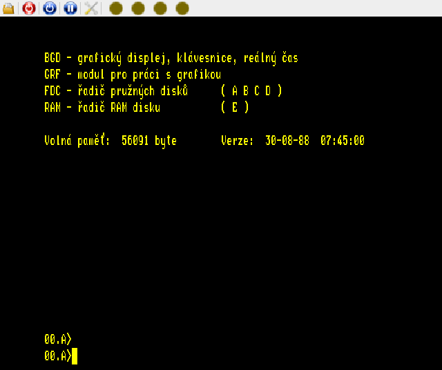

# TNS — C++11 / SDL2

Port emulátoru [omikron88/TNS](https://github.com/omikron88/TNS) z Javy do
C++11. CMake, Linux a Windows/MSYS2; bez Java runtime. Všechny čtyři ROM jsou
vždy vestavěné do programu. GPL-3.0, podrobnosti v [THIRD_PARTY.md](THIRD_PARTY.md).

Zachovává původní Z80, 2MHz časování při 50 snímcích/s, 64–1024 KiB RAM,
mapování/PFL, GC/BGD včetně všech tří rastrových režimů a obou videostránek,
ITK/SC, barevnou i černobílou paletu, klávesové tabulky, čtyři disketové
mechaniky a WAP HDD. Obraz 640×256 se stejně jako v Javě zobrazuje jako
640×512 pomocí nejbližšího souseda. Nástrojová lišta používá původní ikony.
Dialogy jsou napsané v SDL, bez Qt/GTK/SDL_image/SDL_ttf.



## Linux

Na Debianu/Ubuntu:

```sh
sudo apt-get update
sudo apt-get install build-essential cmake libsdl2-dev
cmake -S . -B build -DCMAKE_BUILD_TYPE=Release
cmake --build build -j4
ctest --test-dir build --output-on-failure
./build/tns
```

CMake ≥ 3.16, překladač s C++11 a SDL2 ≥ 2.0.10. Testy SDL používají dummy
videodriver a běží i bez desktopu. Emulační jádro lze sestavit a testovat bez
SDL: `cmake -S . -B build-core -DTNS_BUILD_GUI=OFF`.

## Windows — MSYS2 UCRT64

Otevřete **MSYS2 UCRT64**, nikoli základní MSYS shell:

```sh
pacman -S --needed mingw-w64-ucrt-x86_64-gcc mingw-w64-ucrt-x86_64-cmake \
  mingw-w64-ucrt-x86_64-ninja mingw-w64-ucrt-x86_64-SDL2 git
cmake -S . -B build -G Ninja -DCMAKE_BUILD_TYPE=Release
cmake --build build -j4
ctest --test-dir build --output-on-failure
./build/tns.exe
```

Dynamická varianta potřebuje SDL2.dll a runtime DLL z příslušného MSYS2
prostředí. Přenositelné EXE sestavte následující variantou. CI obsahuje nativní
MSYS2 sestavení a spuštění testů pro obě varianty.

## Přenositelné sestavení

Stejné příkazy fungují na Linuxu i v MSYS2 UCRT64:

```sh
cmake -S . -B build-static -DCMAKE_BUILD_TYPE=Release \
  -DTNS_STATIC=ON -DTNS_BUNDLED_SDL=ON
cmake --build build-static -j4
ctest --test-dir build-static --output-on-failure
```

Výsledný `build-static/tns` nebo `tns.exe` obsahuje SDL2, C++ runtime a ROM.
Na Windows nepotřebuje SDL2.dll, libstdc++ ani libwinpthread DLL. Linux stále
používá systémovou libc/libm a při zobrazení systémové knihovny X11 načítané
SDL. Kvůli kompatibilitě glibc sestavujte linuxový balíček na nejstarší cílové
distribuci; jeden ELF neznamená podporu všech historických verzí Linuxu.
SDL je v této konfiguraci pro Linux sestaveno s X11; na Waylandu použijte XWayland.
Pro grafické sestavení potřebujete vývojové hlavičky X11, např. `libx11-dev
libxext-dev libxrandr-dev libxcursor-dev libxi-dev libxfixes-dev libxrender-dev
libxss-dev libxxf86vm-dev libxinerama-dev` na Debianu/Ubuntu.

CMake stahuje přesně připnuté SDL2 z GitHubu. Offline lze použít
`-DFETCHCONTENT_SOURCE_DIR_SDL2=/cesta/ke/SDL` se zdrojovým stromem uvedeného
commitu. Běh programu připojení k síti nepotřebuje. ROM ani pomocné knihovny
není nutné kopírovat k přenositelné binárce. Diskové obrazy jsou externí a
volitelné; `tns.config` se ukládá do pracovního adresáře.

Volitelný cross překlad na Linuxu s nainstalovaným MinGW-w64:

```sh
cmake -S . -B build-windows -DCMAKE_TOOLCHAIN_FILE=cmake/mingw-w64.cmake \
  -DTNS_STATIC=ON -DTNS_BUNDLED_SDL=ON -DCMAKE_BUILD_TYPE=Release
cmake --build build-windows -j4
```

Cross překlad sám neověřuje běh na Windows.

## Ovládání a média

Lišta zleva: diskety/HDD, reset, NMI, pauza/běh, nastavení a čtyři kontrolky
mechanik. Nastavení nabízí původních 64/256/512/768/1024 KiB, GC či ITK a
černobílou paletu. Změna velikosti RAM nebo karty vyvolá reset. Dialog disků
má pro každou mechaniku a HDD **Open / Eject / New**. Výběr souboru podporuje
procházení adresářů, plnou cestu, vložení ze schránky a přetažení souboru.
Nový obraz je vyplněn E5 stejně jako v Javě; existující soubor se nepřepisuje.
Aktivní disketovou mechaniku nelze vyjmout.

| Zkratka | Akce |
| --- | --- |
| Ctrl+Alt+O | Disky |
| Ctrl+Alt+R | Reset |
| Ctrl+Alt+N | NMI |
| Ctrl+Alt+P | Pauza / běh |
| Ctrl+Alt+S | Nastavení |
| Ctrl+Alt+H | Nápověda |
| Ctrl+Alt+Enter | Celá obrazovka |
| Escape | Zavřít dialog |

F1–F12, Shift, Ctrl, Caps Lock, Scroll Lock a numerický blok používají původní
klávesové tabulky. Scroll Lock přepíná rozšířenou banku funkčních kláves.
Mapování horní řady čísel je původní TNS/české; pro číslice použijte numerický
blok se zapnutým Num Lock. V souborovém dialogu se zadává běžný text hostitele.

Ukázkové původní obrazy jsou v `media/`. Pro zavedení CP/M:

```sh
cp media/tnsdemo.8sd /tmp/tns-demo.8sd
./build/tns --gc --drive1 /tmp/tns-demo.8sd
```

V monitoru `G1>` stiskněte **F**, pak **0 na numerickém bloku s Num Lock**
(první mechanika). Po zavedení se zobrazí CP/M a prompt `00.A>`.
Na Windows si obdobně vytvořte pracovní kopii obrazu. Obrazy se při zápisu
emulovaným systémem mění přímo. HDD ukázka je zazipovaná v `media/demohdd.zip`;
před připojením ji rozbalte.

```sh
./build/tns --itk --ram 256 --hdd demo.hdd
./build/tns --headless --gc --frames 100 --trace --no-save
./build/tns --frames 100 --screenshot screen.ppm --no-save
```

`--help` vypíše všechny volby. `--config SOUBOR` volí konfigurační soubor,
`--no-save` vypne jeho zápis. `--rom-dir ADRESAR` přepíše vestavěné ROM čtyřmi
soubory s původními názvy; přijímá původní velikosti nebo 8192 bajtů na ROM.
Geometrii disket lze zadat v konfiguraci pomocí `BPS1`/`SECTORS1`/`TRACKS1`
a obdobně pro mechaniky 2–4. Výchozí geometrie je 77×26×128, jedna strana,
stejně jako v Javě.

## Ověření a rozdíly

`ctest` kontroluje 3584 instrukčních případů proti Javě, 700 snímků včetně
skutečného zavedení CP/M, RAM, stránkování/PFL, přerušení, klávesnici,
disketový i HDD zápis a ovládání SDL dialogů. Java není k těmto testům potřeba.
Pro kontrolu paměti přidejte `-DTNS_SANITIZERS=ON` v debug sestavení GCC/Clang.
Postup opakování porovnání s Javou a přesný rozsah shody uvádí
[docs/compatibility.md](docs/compatibility.md).
